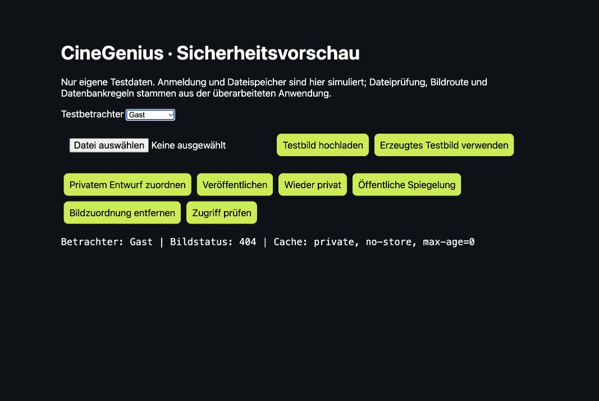
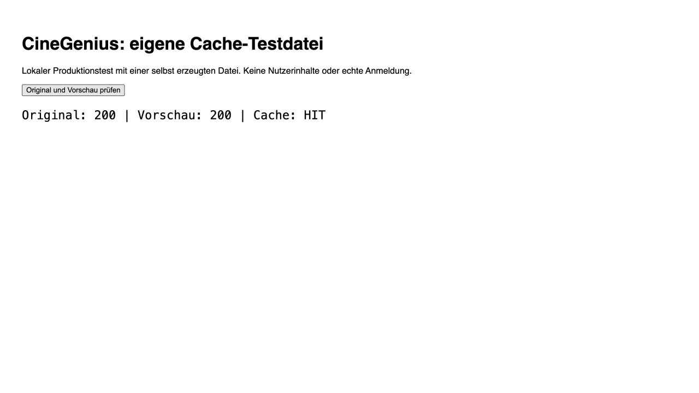
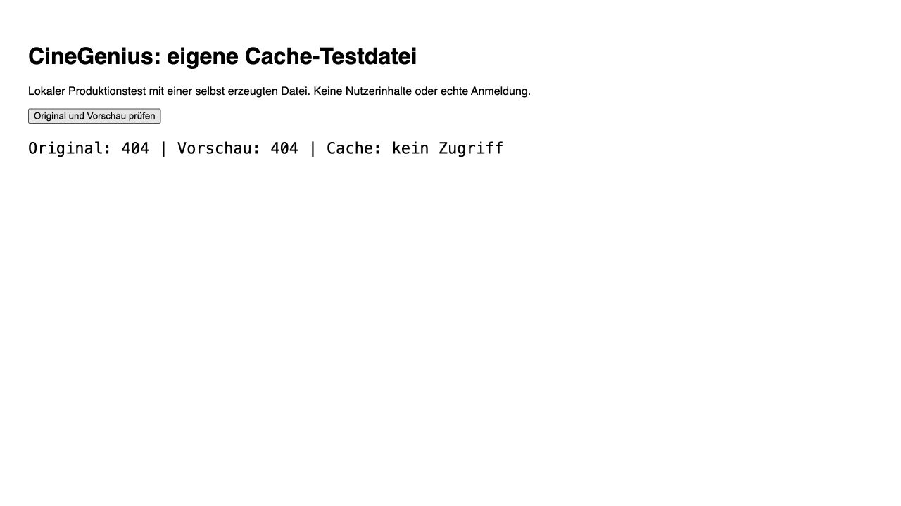

# CineGenius: Sicherheitsprüfung bereichsübergreifender Verknüpfungen

Stand: 27. Oktober 2026. Ausgangscommit `d96629fb31cd254b0a57e6b39a5a846dc4704589`.

## Status und Umfang

Die Anwendungskorrekturen sind lokal geprüft und vom Betreiber zur Veröffentlichung freigegeben. Die additive Datenbankmigration wurde inzwischen in Produktion angewandt und geprüft: privater Bucket, RLS, gesperrte Clientrechte und sieben Herkunftstrigger. Nach ausdrücklicher gesonderter Freigabe wurden genau drei private Originalbilder vorübergehend lokal gesichert, über die Supabase-Oberfläche privat hochgeladen und bytegenau zurückgelesen. Die bisherigen öffentlichen Kopien und Quellenzuordnungen sind zum Zeitpunkt dieses Vorbereitungsstands noch unverändert. Kein Serverschlüssel wurde exportiert, keine Nachrichten oder Einladungen an Mitglieder versendet. Es gab keine Lasttests.

Die Bedienung bleibt erhalten. Kein zusätzlicher Freigabeschalter und kein neues Formular: Ein erfolgreich gespeichertes Bild erscheint nach Zuordnung zu einem öffentlichen Inhalt automatisch dort. Ein ungebundener Upload bzw. privater Entwurf wird dadurch nicht öffentlich. Die Community-Auswahl bleibt ausdrücklich auf persönliche Profilbilder/Portfolio und Firmenbilder begrenzt; Angebote, Locations, eigenständige Projekte und Nachrichten gehören nicht hinein.

Diese Prüfung ist kein Nachweis vollständiger Sicherheit aller Plattformfunktionen. Insbesondere sind die unten genannten Produktions- und Altdateischritte noch offen.

## Nachgewiesene Befunde

| Bereich | Befund | Korrektur / Status |
| --- | --- | --- |
| Uploads | Neue Dateien wurden unmittelbar im öffentlichen Bucket `listing-images` abgelegt. Das Verbergen ihres Datensatzes schützt die direkte Dateiadresse nicht. | Neue Uploads verwenden einen privaten Bucket und eine stabile, bei jedem Abruf geprüfte Bildadresse. Migration noch nicht angewandt. |
| Bestehende private Quellen | Drei vorhandene Storage-Objekte sind ausschließlich privaten Quellen zugeordnet: zwei noch unveröffentlichte Projektentwürfe und eine unveröffentlichte Firma. Sie existieren im öffentlichen Bucket. Keine gemeinsame öffentliche Verwendung in den geprüften Bildfeldern gefunden. | Kontrollierte, wiederaufnehmbare Umstellung vorbereitet; keine realen Dateien verändert. Vorher frisches Inventar, bytegenaue private Kopie, geprüfte Zuordnung, anschließend Stilllegung der alten öffentlichen Kopie. |
| Bildcache | Eine bereits erzeugte gemeinsame Vorschau kann die Sichtbarkeit ihres Originals überleben. | Rechteprüfung vor dem eigenen Vorschaucache; geschützte APIs vom Next-Optimizer ausgeschlossen. Frühere Storage-Varianten werden anhand des Umstellungsjournals vor dessen Cachezugriff gesperrt. |
| Verknüpfte Personen | Firmen-/Projekt-/Referenzansichten hatten teilweise eigene, unvollständige Regeln für verknüpfte private Personen. | Gemeinsame aktuelle Prüfung von Privatsphäre, bestätigten Freundschaften und Sperren, bevor Personeninformationen geladen werden. |
| Firmenequipment | Öffentliche Firmendaten konnten auch unveröffentlichtes Equipment laden. | Öffentliche Datenabfrage verlangt `published=true`. |
| Community | Herkunft und aktueller Quellstatus müssen auch bei einer Spiegelung gelten. Individuelle Sperren dürfen nicht durch Vorschauen umgangen werden. | Kanonische Herkunft im Medienjournal; öffentliche Datenbankansicht und Bildroute prüfen Quelle. Sperren werden vor Trefferzahl/Pagination und vor Bildcache berücksichtigt. |
| Sichtbarkeitsänderungen | Einige Änderungen nutzten verzögert ablaufende Daten-Caches. | Betroffene Tags sofort ungültig; keine gemeinsam zwischengespeicherten geschützten API-Antworten. |
| Bildverarbeitung | Eine passende Dateiendung/MIME-Signatur allein beweist keine dekodierbare, ungefährliche Bilddatei. | Tatsächliche Dekodierung, Pixel-/Frame-/Zeitlimits, Rasterausgabe, EXIF-Entfernung und Ablehnung aktiver SVG-Inhalte. |
| Origin-Prüfung | Ein fremder Origin durfte nicht durch einen passenden Referer überstimmt werden. | Vorhandener Origin ist maßgeblich; nur ausdrücklich vertraute Website-/Deployment-Adressen. |
| Strukturierte Daten und Logs | Rohes JSON im Script und ausführliche Datenbankfehler können Inhalte ungewollt offenlegen. | Vorhandene sichere JSON-LD-Komponente verwendet, E-Mail-Anrede HTML-escaped, Datenbank-/Supportfehler ohne Rohdatensatz oder SQL-Details protokolliert. |
| Pakete | Der Ausgangsstand enthielt bekannte Paketmeldungen. | Kompatible Aktualisierungen, insbesondere Next 16.4.3, Clerk 7.9.21, sharp 0.35.5. Abschließendes Audit aller installierten Pakete: 0 bekannte Meldungen. |

### Read-only-Abgleich der tatsächlichen Produktion

- Alle geprüften öffentlichen Tabellen haben RLS. Direkte Tabellenrechte für `anon`/`authenticated` auf den geprüften Profil-, Angebots-, Nachrichten-, Firmenmitgliedschafts-, Support-, Entwurfs- und Auditdaten sind gesperrt. Keine für diese Clients ausführbare Security-Definer-Funktion im geprüften öffentlichen Schema gefunden.
- Der vorhandene Bucket `listing-images` ist öffentlich und besitzt keine eigene MIME-/Größenbegrenzung. Daher ersetzt Tabellen-RLS keinen Schutz seiner öffentlichen Downloads. Der vorgeschlagene zusätzliche Bucket hat keine öffentlichen Clientrechte.
- Keine öffentlichen Bildverweise bei privaten Personenprofilen, unveröffentlichten Listings oder ausdrücklich privaten Profilbildern im aggregierten Abgleich gefunden. Fünf Entwürfe hatten öffentliche Bildverweise; drei davon gehören bereits veröffentlichten Projekten, zwei sind noch privat. Zusammen mit der privaten Firma ergeben sich die drei umzuziehenden Objekte.
- Keine ablaufenden signierten Bildreferenzen im geprüften Inventar gefunden. Das ist keine Aussage über unbekannte externe URLs oder nicht unterstützte zukünftige Felder.
- Aktuelle Startseitenantwort: HTTPS/HSTS, `nosniff`, Frame-Sperre, CSP mit Nonce. Alle 68 ausgelieferten Script-Nonces passten zur geprüften CSP-Antwort.
- 15 öffentlich geladene Startseiten-Scriptdateien, zusammen 868.173 Bytes, auf hochspezifische geheime Schlüssel und Service-Role-JWTs geprüft: keine Treffer. Keine vollständige Prüfung der Git-Historie, aller Seitenbundles oder aller Laufzeitgeheimnisse.
- Clerk-Produktion: Authenticator, Backupcodes und MFA-Pflicht sind ausgeschaltet. Nichts geändert. Eine persönliche Einrichtung muss vor einer Pflicht erfolgen, damit niemand ausgesperrt wird.
- Supabase zeigt sieben tägliche Datenbanksicherungen (20.–26. Oktober). Letzte angezeigte Sicherung: 26. Oktober, 23:03:42 UTC. Diese Sicherungen enthalten laut Produktanzeige **keine Storage-Dateiinhalte**. Wiederherstellung wurde nicht ausgelöst oder getestet.

## Zentrale Änderungen und Dateien

- `lib/protected-media.ts`, `lib/protected-media-server.ts`, `app/api/media/[...path]/route.ts`: kanonisches Medienjournal, private Ablage, wiederholbare unveränderliche Uploads, bestätigte Speicherung, Zugriffsprüfung auf aktuelle Quelle und Eigentümerschaft.
- `supabase/migrations/20261027180000_protected_media.sql`: privater Bucket, servicegeschütztes Medienjournal und Hilfsfunktionen, Herkunftsbindung, aktuelle Rechte bei Original- und Vorschauabruf, erlaubte Community-Quellen und Altdatei-Umstellungsjournal. Bestehende öffentliche Objekte werden durch die Migration nicht verschoben oder gelöscht.
- `app/api/upload/*`, `app/api/profile/avatar/route.ts`, `app/api/listings/[id]/publish/route.ts`: bestehende Uploadwege an die private Ablage angebunden. Eine fehlgeschlagene Zuordnung meldet keinen Erfolg; vorherige zugeordnete Bilder bleiben erhalten.
- `components/MediaImage.tsx`: vorhandene Bildkomponente mit gleicher Oberfläche; geschützte Bilder verwenden geprüfte Vorschaugrößen. Die Importumstellungen in Karten, Profilen, Galerien und Navigation ändern keine Layoutregeln.
- `lib/media-optimizer-guard.ts`, `proxy.ts`: Sperre vor dem gemeinsamen Bildcache, einschließlich kodierter und normalisierter Varianten; strenge Origin-Prüfung über `lib/request-origin.ts`.
- `lib/linked-profile-access.ts`, `lib/trust.ts`: gemeinsame aktuelle Sichtbarkeitsprüfung. Angebunden an Firmenmitglieder, Projektcredits, Kooperationen, Empfehlungen und öffentliche Profilansichten; bei fehlgeschlagener Rechteabfrage keine Freigabe fremder Inhalte.
- `lib/community-media-server.ts`, `app/api/community-image/route.ts`: erlaubte Herkunft, aktuelle Sperren, keine Freigabe durch eine zusätzliche Darstellung, Prüfung vor Vorschaucache.
- `app/api/user-settings/route.ts` sowie betroffene Firmen-/Listing-Änderungsrouten: sofortiges Verwerfen betroffener Daten-Caches.
- `app/api/admin/media/check/route.ts`: Diagnose von Existenz und Zugriffsproblem ohne Herunterladen privater Originale und ohne implizite private Bildrechte für Plattformadmins.
- `lib/uploadGuard.ts`: sichere begrenzte Bilddekodierung und Rasterverarbeitung. `lib/db.ts`, Supportrouten, Clerk-Webhook und JSON-LD-Verwendungen: gezielte Ausgabesicherheit.
- `scripts/audit-media-origins.mjs`, `scripts/lib/private-media-cutover.mjs`: standardmäßig schreibfreies Inventar; gesonderter, exakt auf Projekt und Dateianzahl begrenzter Umstellungslauf. Unklare Eigentümerschaft, gemischte öffentliche/private Nutzung, fehlende Originale oder ungeeignete Originalformate stoppen den Lauf.
- `messages/{de,en,es,it,cs,hu}.json`: neue Uploadfehlermeldungen in allen sechs Katalogen. Vorhandene Übersetzungslücken der Plattform bleiben als solche ausgewiesen.
- `AGENTS.md`: verbindliche Regeln für zukünftige Uploads, Herkunft, Vorschaubilder, Privatsphäre und ehrliche Grenzen alter öffentlicher Adressen.
- `package.json`, `package-lock.json`: kompatible Sicherheitsaktualisierungen. Kein zusätzlicher kostenpflichtiger Dienst.

## Tatsächlich bestandene Prüfungen

Gesamte Testsuite: **673 bestanden, 0 fehlgeschlagen**. Darin sind bestehende Plattformtests und die gezielten neuen Sicherheitsprüfungen enthalten; nicht alle 673 sind neue Sicherheitstests.

### Datenbank und Route-Tests mit eigenen Fixtures

- Tatsächliche neue PostgreSQL-Funktionen/Migration mit PGlite ausgeführt: ungebundener Upload, privater Entwurf, Veröffentlichung, erneute Privatstellung, Ersetzen und Löschen der Zuordnung; Gast, Eigentümer und fremdes Mitglied.
- Öffentliches Spiegeln einer privaten Datei hebt deren kanonische Herkunft nicht auf. Eine Bildadresse in einer Beschreibung/Bildunterschrift bindet keine Datei und erhält keine Bildrechte.
- Private Profile, einzelne private Profilbilder, bestätigte Freundschaften und Sperren in beiden Richtungen; unbekannte oder fehlerhafte Rechteabfrage verweigert fremden Zugriff.
- Geänderte Eigentümerschaft und beendete Firmenzugehörigkeit werden beim nächsten Zugriff berücksichtigt. Öffentliche Tätigkeitsbezeichnungen vergeben keine technischen Bildrechte.
- Veröffentlichung eines Projektentwurfs übernimmt die erlaubte kanonische Projektzuordnung; spätere Entfernung des eigentlichen Projekts macht die Datei nicht über eine fremde Spiegelung öffentlich.
- ID-Austausch in Kooperationen, Empfehlungen und Projektcredits: privates Ziel wird vor Abfrage verknüpfter Identitäten mit 404 abgelehnt.
- Normale Mitglieder können die Admin-Mediendiagnose nicht ausführen. Ein Plattformadmin erhält dadurch keine privaten Bildbytes.
- Firmenansicht lädt nur veröffentlichtes Equipment und erlaubte verknüpfte Identitäten; geänderte Privatsphäre wird neu geprüft.
- Community: explizite Herkunftsliste vor Pagination, aktuelle Sperren vor Trefferzahlen; bereits erzeugte Vorschau wird nach Entzug nicht erneut ausgeliefert.
- Upload: unveränderlicher Pfad/Hash, Wiederholung derselben Datei, abweichende Bytes unter demselben Uploadschlüssel, verlorene Storage- und Datenbankbestätigungen, gezielte Bereinigung nur eigener ungebundener Dateien.
- Echte PNG/JPEG/WebP-Dekodierung und Rasterausgabe; gefälschter JPEG-Header, aktive SVG-Datei und überschrittenes Pixellimit werden abgelehnt. Kein realer Gerätetest für HEIC-Konvertierung.
- Strenger Origin trotz passendem Referer; JSON-LD bleibt bei Script-Abbruchtext syntaktisch gültig und escaped.
- Altdatei-Umstellung mit eigenen Bytes und Storage-Simulation: bytegenaue Kopie, private Zuordnung, Erhalt von Reihenfolge/Beschreibungen, verweigerter fremder Eigentümer, Wiederholung nach abgebrochener Stilllegung ohne Verlust des privaten Originals.

### Browsernachweis, ausdrücklich lokale Simulation

Lokale Testseite mit tatsächlicher Upload-/Bildroute und tatsächlichen PostgreSQL-Regeln; Anmeldung, Storage und Zustandswechsel sind eigene Testadapter, keine echte Clerk-/Supabase-Produktion:

1. Selbst erzeugtes Bild hochgeladen: Eigentümer erhält 200 und eine sichtbare Vorschau.
2. Privatem Entwurf zugeordnet und zusätzlich öffentlich gespiegelt: Gast erhält 404.
3. Eigene Quelle veröffentlicht: Gast erhält 200.
4. Dieselbe Quelle wieder privat: Gast erhält 404 trotz bereits vorhandener Ableitung; Eigentümer weiterhin 200.

Separater **echter Next-16.4.3-Produktionsbuild** mit tatsächlichem Projekt-Proxy, eigener Testdatei und einer ausschließlich im lokalen Testprojekt simulierten Clerk-Anbindung:

1. Schutz deaktiviert, Vorschau aufgerufen: 200/MISS, danach 200/**HIT**.
2. Gleicher vorhandener Bildcache, Schutz aktiviert: Original 404 und Vorschau 404. Die alte gespeicherte Vorschau wurde nicht ausgeliefert.

Keine Testadapter, Testseiten oder simulierten Anmeldungen sind Teil der Anwendung oder eines Produktionsdeployments. Browsernachweise sind Desktop-/lokale Tests; keine behaupteten iPhone-/Android-Gerätetests.

### Entwicklungsprüfungen

- Produktionsbuild mit Next 16.4.3 erfolgreich, einschließlich TypeScript und 133 erzeugten Seiten.
- Separater TypeScript-Lauf nach dem abgeschlossenen Build ebenfalls bestanden. Ein gleichzeitig mit dem Neuaufbau gestarteter Lauf hatte vorübergehend doppelte generierte Next-Typdateien gesehen; die neu erzeugten Typen wurden anschließend erfolgreich geprüft.
- Übersetzungsprüfung: sechs Kataloge, 1.248 Schlüssel, keine neuen unübersetzten UI-Literale. Bestehender Übersetzungsrückstand nicht als erledigt ausgegeben.
- Gemeinsame Designprüfung bestanden; keine beabsichtigte Änderung der Benutzeroberfläche.
- Lint der neuen zentralen Sicherheitsmodule und Bildrouten ohne Befund. Der breitere Lint-Lauf meldet 13 bestehende React-Regelverstöße. Vergleich derselben Dateien aus HEAD mit aktuellem ESLint bestätigt identische Regeln und Positionen. Keine sachfremden Hook-Refactorings vorgenommen.
- `npm audit` einschließlich Entwicklungsabhängigkeiten: 0 bekannte Meldungen; keine Garantie gegen unbekannte Schwachstellen.

## Offene Produktionsschritte und Grenzen

1. **Migration in Produktion angewandt und geprüft; Anwendung zur Veröffentlichung freigegeben.** Der neue Bucket ist privat, `media_assets` hat RLS, anonyme Tabellenrechte und authentifizierte RPC-Direktaufrufe sind gesperrt; sieben Herkunftstrigger vorhanden. Private Kopien vor Veröffentlichung auf direkten Gastzugriff geprüft. Anschließend Anwendung gemäß Releasevorgabe veröffentlichen und produktive Bildroute nachprüfen.
2. **Umstellung von drei vorhandenen privaten Dateien ausdrücklich freigegeben, einschließlich vorübergehender lokaler Kopien.** Der vorbereitete Lauf kopiert und prüft Originalbytes, ändert nur deren Bildverweise und entfernt danach die alte öffentliche Kopie. Die Originaldatei bleibt privat erhalten. Diese konkrete Freigabe wurde eingeholt. Eine automatische Freigabeprüfung hatte einen Export des privilegierten Serverschlüssels abgelehnt; deshalb wird die Umstellung ohne Schlüsselexport über die Supabase-Oberfläche vorgenommen. Veränderte Inventarzahlen, mehrdeutige Quellen oder ungeeignete Dateien erfordern erneute Prüfung.
3. **Weitere heute öffentliche Altdateien werden nicht pauschal umgezogen.** Ihre dauerhaften öffentlichen Originaladressen bleiben bis zu einer kontrollierten Umstellung öffentlich. Das gilt auch für eine spätere Privatstellung eines solchen Altdatensatzes: Die neue Pipeline schützt nicht rückwirkend die alte Storage-Adresse. Eine weitere geprüfte Bestandsumstellung bzw. passende Lebenszyklusintegration ist hierfür nötig. Der gesamte historische Dateilebenszyklus ist deshalb noch nicht vollständig abgesichert.
4. Frühere öffentliche Downloads und Kopien bei Dritten lassen sich nicht zurückholen. Nach Umstellung Storage-Auslieferung, ursprüngliche und optimierte Adressen sowie Anwendungs-/CDN-Caches tatsächlich prüfen. Kein Versprechen einer sofortigen weltweiten Löschung.
5. Persönliche MFA-Einrichtung für berechtigte Verantwortliche ist offen. Keine globale Pflicht ohne vorherige Einrichtung/Notfallzugang setzen. Vercel-WAF-, Clerk-Bot-/Missbrauchs- und alle Rate-Limit-Einstellungen wurden nicht vollständig in Produktion geprüft. Die vorhandene IP-Sperre im Anwendungsspeicher bleibt nur ein Schutz pro Instanz; vorhandene datenbankgestützte Limits der geprüften kritischen Routen sind davon getrennt.
6. Storage-Dateisicherung und geprobte Wiederherstellung sind offen. Datenbanksicherungen allein decken Dateiinhalt nicht ab. Keine zusätzlichen kostenpflichtigen Produkte aktiviert.
7. Keine echte Registrierung/Passwortwiederherstellung oder Mehrgeräte-Abmeldung mit neuen Produktionskonten durchgeführt. Keine vollständige Prüfung jeder Adminaktion, Zahlungsfunktion oder der gesamten Quellcodehistorie behauptet.
8. Nachrichten und Support sind in der geprüften Implementierung textbasiert. Kein funktionierender Uploadweg für Nachrichten-/Supportanhänge gefunden; daher keine erfundenen Anhangtests. Zukünftige Anhänge müssen an die tatsächliche Unterhaltung und deren Teilnehmerrechte gebunden werden, nicht an öffentliche Bildquellen.

Die Sicherheitsänderungen sind damit ein überprüfter, vorbereiteter Schritt. Ein vollständiger Produktionsabschluss setzt die genannten Live-Prüfungen und die Entscheidung zur Behandlung der verbleibenden Altdateien voraus.
